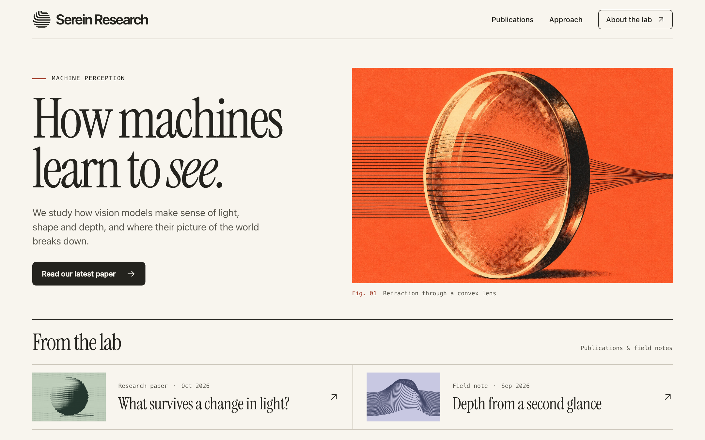

# links-skills

给 Codex 和 Claude Code 使用的技能集合。

## 安装 product-ui-craft

把下面这句话发给你的 Agent：

> 请读取 https://github.com/linksyou/links-skills/blob/main/agent.md ，按文档在本机安装 product-ui-craft，并验证安装结果。

[product-ui-craft](skills/product-ui-craft/README.md) 用于设计、实现和打磨产品界面，附有设计规范模板、交互测试模板和浏览器检查脚本。

## product-ui-craft 效果示例

### Serein Research · 机器视觉研究实验室官网

首页用一句「How machines learn to see」点出研究方向，右侧的凸透镜图版把光线折射画了出来。点开下方的研究论文或实验手记，可以读到对应的实验方法。

### Marginalia · 数据分析对话助手

读者在对话里附上一份阅览室客流表，问工作日和周末分别几点最忙。Marginalia 用两条折线标出高峰时段。点击「View source data」能核对原始数值，也可以在输入框里接着问某个时段的客流。

两张图均为浏览器实截。下载仓库后，双击示例目录里的 `index.html` 即可离线体验。实验室、论文和客流数据均为虚构示例，光学主图由 ImageGen 生成。对话回答由原型在本地计算。[官网原型](examples/product-ui-craft/atelier-serein/) · [对话产品原型](examples/product-ui-craft/marginalia/)
