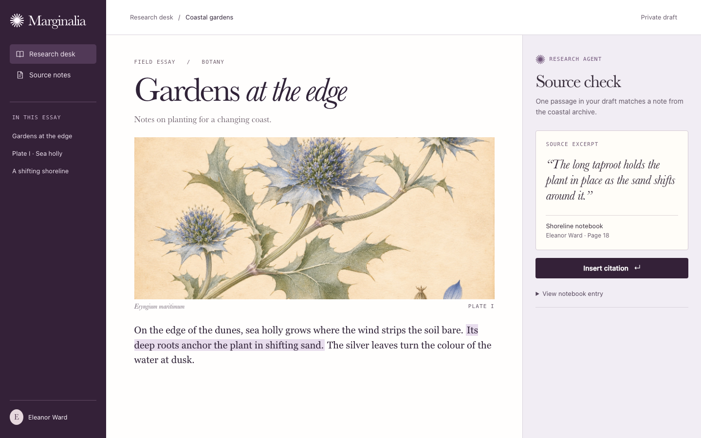

# links-skills

给 Codex 和 Claude Code 使用的技能集合。

## 安装 product-ui-craft

把下面这句话发给你的 Agent：

> 请读取 https://github.com/linksyou/links-skills/blob/main/agent.md ，按文档在本机安装 product-ui-craft，并验证安装结果。

[product-ui-craft](skills/product-ui-craft/README.md) 用于设计、实现和打磨产品界面，附有设计规范模板、交互测试模板和浏览器检查脚本。

## product-ui-craft 效果示例

### Atelier Serein · 建筑事务所官网

首页以一幅陶土色海岸庭院的全景图介绍 Casa Marea。项目标题、地点和项目手记入口叠在照片下沿，向下阅读即可看到建筑师如何围绕一棵松树组织庭院。

### Marginalia · 引文核对 Agent

编辑阅读植物随笔时，可以对照正文中高亮的句子和右栏的笔记摘录。展开笔记可读上下文，点击「Insert citation」会将引文编号和脚注插入稿件，也可以撤销。

两张效果图均来自按本技能设计的 HTML 原型。下载仓库后，在任一示例目录双击 `index.html` 即可体验。建筑场景和植物插画为生成素材，项目、稿件和引用均为虚构示例。[官网原型](examples/product-ui-craft/atelier-serein/) · [Agent 原型](examples/product-ui-craft/marginalia/)
