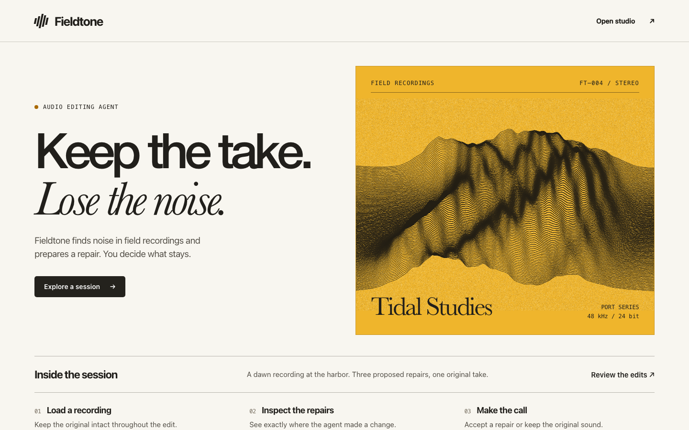
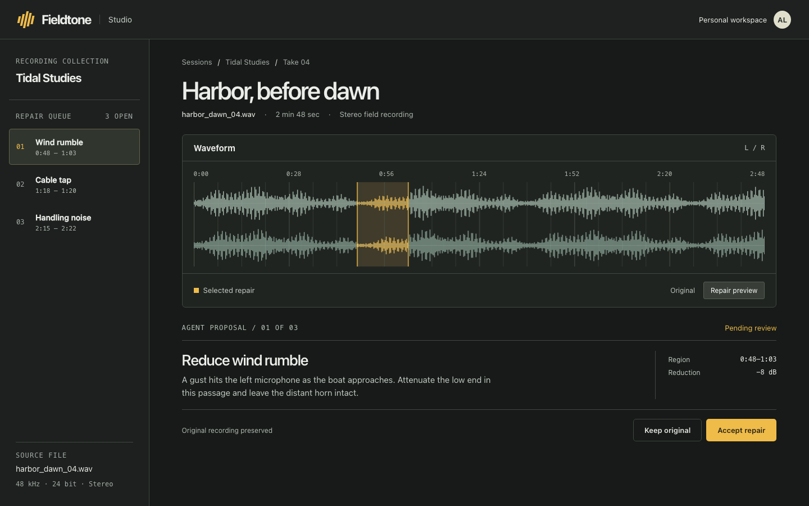

# links-skills

给 Codex 和 Claude Code 使用的技能集合。

## 安装 product-ui-craft

把下面这句话发给你的 Agent：

> 请读取 https://github.com/linksyou/links-skills/blob/main/agent.md ，按文档在本机安装 product-ui-craft，并验证安装结果。

[product-ui-craft](skills/product-ui-craft/README.md) 用于设计、实现和打磨产品界面，附有设计规范模板、交互测试模板和浏览器检查脚本。

## product-ui-craft 效果示例

Fieldtone 是为这组示例设计的虚构音频编辑 Agent。以下两张图截自浏览器中的原型。

### 产品官网

第一次来访的录音师可以从首页进入一段港口录音，了解 Agent 如何协助修复噪声。右侧用这段录音的虚构唱片封套作为主视觉。

### Agent 工作台

录音师打开同一段录音后，可以从左侧选择修复建议。图中选中的是 0:48 至 1:03 的风噪。波形高亮对应片段，审核区给出调整原因和衰减量，录音师可以接受修复或保留原声。

两张图均为 1440 × 900 的桌面截图。原型已在 Chromium 和 WebKit 的桌面、手机视口验证页面跳转和审核操作。波形和修复建议为演示数据。
